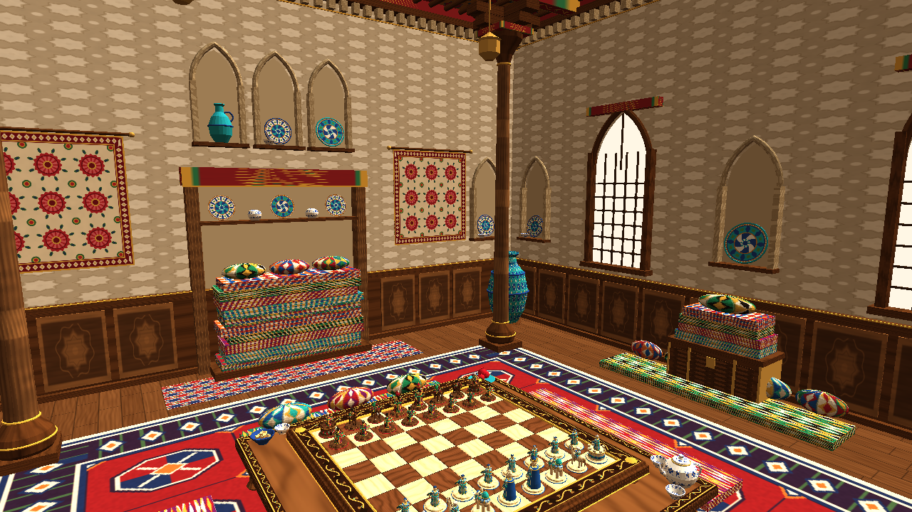
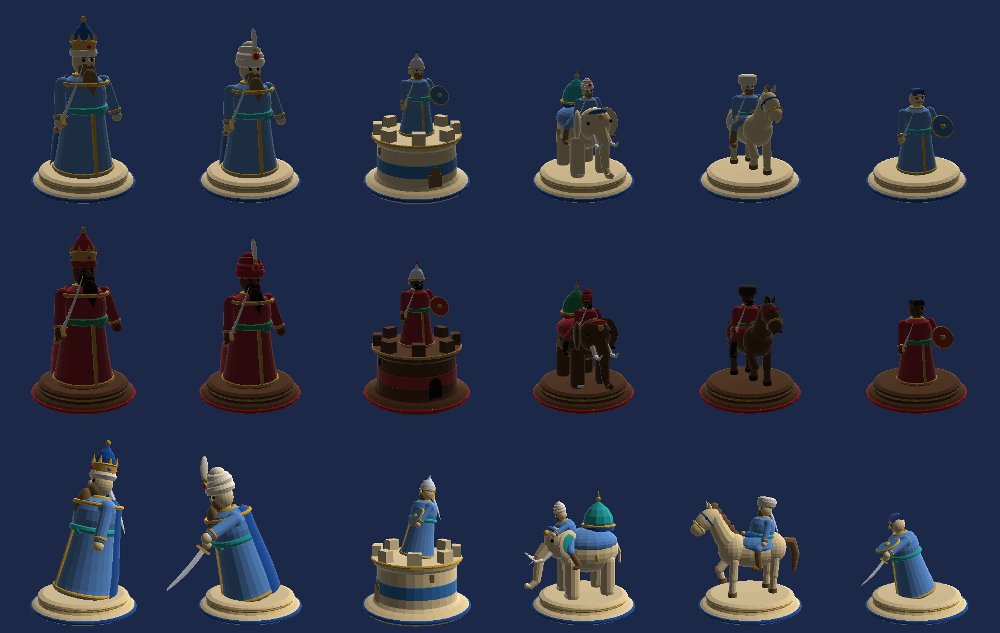

# Shox va Mot

3D-шахматы для Android на Unity в узбекском стиле. Фигуры — деревянные узбекские персонажи с саблями. Каждое взятие разыгрывается как поединок: нападающий подходит к противнику, замахивается и рубит, а деревянная фигура разлетается на резные детали (физика, щепки, искры, замедление времени).





> Превью сделаны упрощённым программным рендером по той же геометрии и тем же процедурным текстурам, что строит игра. Карт нормалей, теней, отражений и света Unity на них нет — в игре картинка богаче.

## Что в игре

| | |
|---|---|
| **Режим** | Два игрока на одном устройстве, по очереди (pass-and-play). Кнопка «Против компьютера» уже стоит в меню с пометкой «Скоро». |
| **Правила** | **Классические шахматы** (рокировка, взятие на проходе, превращение, мат, пат, троекратное повторение, правило 50 ходов, недостаточный материал) и **древний шатрандж «Афросиёб»**: Фарзин ходит на 1 поле по диагонали, Фил прыгает ровно на 2 поля по диагонали, пешка без двойного хода превращается только в Фарзина, рокировки нет, пат и «голый король» дают победу. |
| **Часы** | Без часов, 3+2, 5, 10, 15+10, 30 минут. Пока идёт анимация, часы стоят. |
| **Бой** | Подход, замах, удар саблей, защита щитом, разлёт фигуры на физические обломки, щепки, искры, вспышка, тряска камеры, замедление, вибрация. Три режима: полные сцены, быстрые или без анимации. |
| **Пахлавон** | Фигура, победившая троих, получает звание «Пахлавон»: золотое кольцо, искры и фанфары. |
| **Мир** | Мехмонхона — парадный деревянный зал узбекского дома: резные панели (хивинская резьба), стены из резного ганча с нишами-токча, риштанские ляганы и кувшины, тахмон со стопками курпачей, хивинская резная дверь, окна с решётками-панжара, резные колонны-устун, расписной потолок с балками, бухарский гилам, палосы, сюзане, сундук, дутар, дойра, изразцовые хумы. Доска стоит на хонтахте; рядом курпачи, чайник «пахта», лепёшка-нон, гранаты, виноград, наввот, фонари-чироқ. Три времени суток: солнце из окон с лучами и пылинками, закат, ночь при фонарях. |
| **Доска** | Плитки-клетки из чинары и ореха с фаской, золотой валик, широкая рама с позолоченной резной лозой ислими, профилированный карниз, боковины с гирих-резьбой, точёные ножки, золотые розетки. |
| **Графика** | Карты нормалей для всей резьбы и волокон дерева, проба отражений с box-проекцией (золото и лак отражают зал), контактные тени под фигурами, мягкие тени, лучи света, виньетка. |
| **Музей Афросиаба** | Витрина персонажей: фигуру можно вращать пальцем, читать её историю и правила хода, а по кнопке «Атака!» она разрубает узбекскую дыню. |
| **Звук** | Весь звук синтезируется кодом: музыка на дутаре и нае с дойрой, удар клинка, треск дерева, «шах» на дойре, фанфары карная. |
| **Интерфейс** | **O'zbekcha** (латиница, язык по умолчанию), **Ўзбекча** (кириллица), русский, английский. Язык переключается кнопкой в правом верхнем углу главного меню. Ляпис, золото, бирюза, восьмиконечные звёзды, лента ислими. Главное меню, новая игра, настройки, правила, музей, статистика, пауза, итог партии, выбор превращения, подтверждения. |
| **Прочее** | Автосохранение и кнопка «Продолжить», отмена хода, предложение ничьей, сдача, реванш, поворот доски к ходящему игроку, подсказки ходов, координаты, узбекские пословицы на загрузке и в итогах партии. |

Все модели, текстуры, звуки и интерфейс генерируются кодом при запуске. Внешних ассетов нет, кроме иконки приложения.

## Как открыть

1. Установите **Unity 2022.3 LTS** через Unity Hub и добавьте модуль **Android Build Support** (с OpenJDK и Android SDK & NDK).
2. В Unity Hub: **Add → Add project from disk** и выберите папку `ShoxVaMot`.
3. При первом открытии скрипт `ShatranjProjectSetup` сам:
   - создаёт `Assets/Resources/ShatranjStandard.mat` (без него шейдер Standard не попадёт в сборку);
   - создаёт сцену `Assets/Scenes/Main.unity` и добавляет её в Build Settings;
   - выставляет для Android: портретную ориентацию, IL2CPP, ARM64 и ARMv7, minSdk 24, пакет `uz.shoxvamot.game` и иконку;
   - добавляет шейдеры текста и спрайтов в Always Included и сохраняет варианты шейдеров с линейным туманом.
4. Нажмите **Play**. Игра собирает себя сама через `RuntimeInitializeOnLoadMethod`, поэтому работает в любой сцене, даже в пустой.

Повторить настройку можно через меню **Shox va Mot → Setup Project**. Автоматически параметры плеера применяются только один раз (маркер `ProjectSettings/ShoxVaMotConfigured.txt`), чтобы не затирать ваши изменения.

## Сборка для Android

- **Shox va Mot → Build Android APK** — файл `Builds/Android/ShoxVaMot.apk`. Установка: `adb install -r Builds/Android/ShoxVaMot.apk`.
- **Shox va Mot → Build Android App Bundle (Google Play)** — файл `Builds/Android/ShoxVaMot.aab`.
- Из командной строки:
  ```
  Unity -batchmode -quit -projectPath ShoxVaMot -executeMethod Shatranj.EditorTools.ShatranjProjectSetup.CIBuildApk
  ```
- Для Google Play настройте подпись: Player Settings → Publishing Settings → Keystore.

## Реклама (Unity Ads)

Перед каждой новой партией, реваншем и продолжением сохранённой игры показывается межстраничная реклама Unity Ads. Если ролик не успел загрузиться за 3 секунды, партия начинается без рекламы. Пока идёт реклама, звук игры приглушается.

Чтобы реклама заработала:
1. В [Unity Dashboard](https://dashboard.unity3d.com) создайте проект, включите **Monetization → Unity Ads** и скопируйте **Game ID** для Android (и iOS).
2. Впишите их в `Assets/Scripts/Core/AdsConfig` (файл `AdsManager.cs`): `AndroidGameId`, `IosGameId`. ID рекламных блоков по умолчанию: `Interstitial_Android` / `Interstitial_iOS`.
3. Для проверки оставьте `TestMode = true` — будут показываться тестовые ролики. Перед публикацией поставьте `false`.
4. `MinSecondsBetweenAds` задаёт паузу между показами: 0 — реклама перед каждой партией.

Пакет `com.unity.ads` (Advertisement Legacy 4.4.2) уже прописан в `Packages/manifest.json`. Редакторский скрипт сам включает символ `SHOX_UNITY_ADS`, когда пакет установлен, поэтому без пакета проект тоже собирается, просто без рекламы. Для публикации в Google Play укажите в консоли, что приложение содержит рекламу, и при необходимости добавьте окно согласия (GDPR) для пользователей из ЕС.

## Управление

- Нажмите на свою фигуру: подсветятся ходы (точка — пустая клетка, кольцо — взятие). Затем нажмите на клетку.
- Свайп одним пальцем вращает камеру, щипок двумя пальцами приближает. В редакторе: мышь и колесо.
- Кнопки внизу: **Меню** (пауза), **Отмена** (вернуть ход), **Вид** (развернуть доску).
- Аппаратная кнопка «Назад» на Android закрывает диалоги и открывает паузу.

## Структура

```
ShoxVaMot/
├─ Assets/
│  ├─ Art/AppIcon.png                 иконка приложения
│  └─ Scripts/
│     ├─ Chess/        движок без зависимостей от Unity
│     │   ChessTypes.cs     фигуры, поля, ход, флаги
│     │   Position.cs       доска, FEN, генерация ходов, шах, make/unmake, perft
│     │   ChessGame.cs      партия: история, SAN-нотация, мат/пат/ничьи, голый король
│     │   PieceTracker.cs   постоянные id фигур (счётчик побед, «Пахлавон», отмена хода)
│     ├─ Core/
│     │   GameRoot.cs        точка входа, загрузка, переходы, настройки
│     │   MatchController.cs логика партии, часы, сохранение, статистика
│     │   BoardInput.cs      тапы, вращение и зум камеры
│     │   GameSettings.cs    настройки, конфиг партии, сохранение, статистика
│     │   Loc.cs             локализация uz/ru/en и пословицы
│     ├─ Visual/
│     │   PieceFactory.cs    «резчик»: 6 персонажей из процедурных деталей
│     │   PieceView.cs       анимации: походка, прыжок, удар, защита, ликование, падение
│     │   MeshBuilder.cs     тела вращения, торы, трубки, клинок сабли
│     │   TextureFactory.cs  дерево, икат, тюбетейка, майолика, сюзане, ислими…
│     │   MaterialLib.cs     материалы сторон (чинара+ляпис / орех+гранат)
│     │   BoardView.cs       доска, подсветки, анимация ходов и поединков
│     │   Fx.cs              искры, щепки, разлёт на обломки, салют, замедление
│     │   BoardModel.cs      резная доска: плитки с фаской, рама, ножки
│     │   InteriorBuilder.cs мехмонхона: стены, ниши, тахмон, дверь, окна, колонны, потолок
│     │   TextureFactory.Uzbek.cs  рельефы и карты нормалей: ислими, гирих, ганч, панели, гилам, керамика
│     │   EnvironmentBuilder.cs  свет, отражения, лучи, пылинки, время суток
│     │   CameraRig.cs       орбитальная камера, наезд на бой, тряска
│     │   IconRenderer.cs    иконки фигур для UI и витрина музея
│     ├─ Audio/
│     │   SoundSynth.cs      синтез: дутар, дойра, най, карнай, удары
│     │   AudioManager.cs    воспроизведение
│     ├─ UI/
│     │   UIKit.cs           компоненты интерфейса в узбекском стиле
│     │   UIManager.cs       экраны, оверлеи, баннеры, кнопка «Назад»
│     │   MenuScreens.cs     загрузка, меню, новая игра, настройки, правила, статистика, музей
│     │   GameScreens.cs     HUD, пауза, итог, превращение, подтверждение
│     └─ Editor/ShatranjProjectSetup.cs  автонастройка и сборка
├─ Docs/GDD.md               гейм-дизайн документ и дорожная карта
├─ Tools/EngineTests/        тесты шахматного движка (.NET)
├─ Packages/manifest.json
└─ ProjectSettings/ProjectVersion.txt
```

## Как добавить ИИ

Движок уже готов для поиска ходов: `Position.GenerateLegal`, `Make`/`Unmake`, `InCheck`, `Pc.Value`. Подключение:

1. Создайте `Assets/Scripts/AI/ShatranjAI.cs` с методом вида `Move Think(Position p, int depth)` (alpha-beta с оценкой материала и позиции). Считайте в фоновом потоке на копии позиции: `pos.Clone()`.
2. В `MatchController` после хода человека (в конце `AnimateRoutine`), если `Config.mode == GameMode.VsAI` и ход компьютера, запустите расчёт и вызовите `Commit(move)`. Это тот же метод, через который ходит человек.
3. В `NewGameScreen` включите кнопку «Против компьютера» (`ai.interactable = true`) и добавьте выбор уровня: Shogird / Usta / Amir Temur.

## Проверка

- **Шахматный движок** покрыт тестами: perft на 5 эталонных позициях (до 197 281 узла), мат, пат, рокировка, повторение, превращение, SAN, правила Афросиёба, голый король, трекер фигур.
  ```
  cd Tools/EngineTests && dotnet run -c Release
  ```
- **Unity-скрипты** скомпилированы без ошибок и предупреждений против справочных сборок UnityEngine 2021.3/2022.3 (рантайм) и UnityEditor (Editor-скрипт).
- **Геометрия персонажей** и поза удара проверены программным рендером по той же сборке модели (картинки в `Docs/`).
- **В самом редакторе Unity проект пока не запускался**: в среде разработки Unity не было. При первом открытии проверьте консоль. Если что-то не так, пишите, исправлю.

## Лицензия и происхождение

Код, модели, текстуры, музыка и звуки созданы процедурно для этого проекта. Узоры (икат-адрас, сюзане, гирих, ислими, «пахта») — стилизация традиционных орнаментов.
