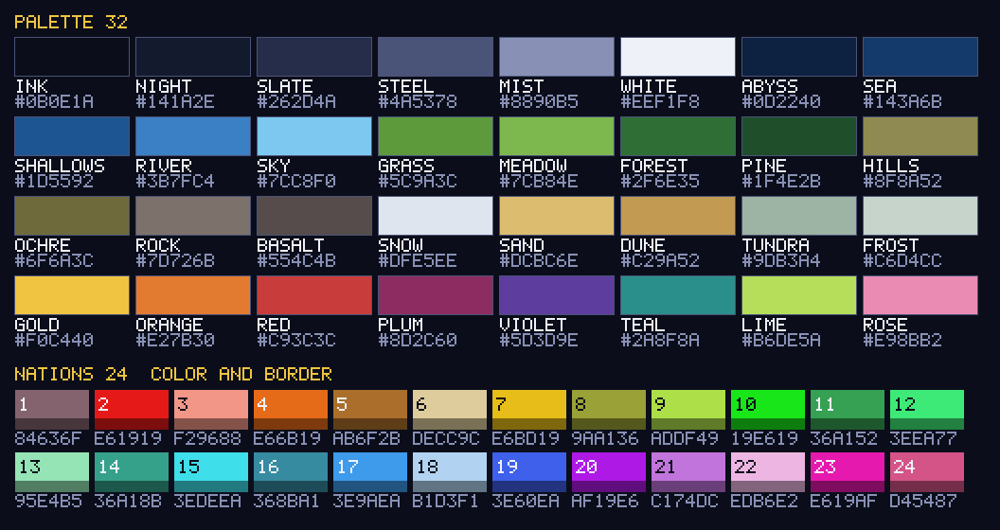

# Палитра «Фронтира»

32 цвета в духе 16-bit. Источник в коде — `src/shared/Palette.luau`; тест `tests/Palette.spec.luau`
проверяет, что эта таблица и код совпадают. Рисовать можно только этими цветами.

Картинку пересоздаёт `lune run tools/palette_preview` (тест падает, если она устарела).

> Черновик палитры собран на этапе 1 для плейсхолдеров. Геймдизайнер может заменить любые hex — имена цветов
> трогать не нужно, код ссылается на имена.

| # | Имя | Hex | Назначение |
|---|---|---|---|
| 1 | Ink | `#0b0e1a` | фон экрана, самые тёмные тени |
| 2 | Night | `#141a2e` | фон панелей UI |
| 3 | Slate | `#262d4a` | тёмные детали UI |
| 4 | Steel | `#4a5378` | рамки панелей (1 px) |
| 5 | Mist | `#8890b5` | второстепенный текст |
| 6 | White | `#eef1f8` | основной светлый текст |
| 7 | Abyss | `#0d2240` | глубокое море |
| 8 | Sea | `#143a6b` | море |
| 9 | Shallows | `#1d5592` | мель у берега |
| 10 | River | `#3b7fc4` | реки |
| 11 | Sky | `#7cc8f0` | голубые цифры UI, блики воды |
| 12 | Grass | `#5c9a3c` | равнина |
| 13 | Meadow | `#7cb84e` | равнина, оттенок |
| 14 | Forest | `#2f6e35` | лес |
| 15 | Pine | `#1f4e2b` | лес, оттенок |
| 16 | Hills | `#8f8a52` | холмы |
| 17 | Ochre | `#6f6a3c` | холмы, оттенок |
| 18 | Rock | `#7d726b` | горы |
| 19 | Basalt | `#554c4b` | горы, оттенок |
| 20 | Snow | `#dfe5ee` | снежные вершины |
| 21 | Sand | `#dcbc6e` | пустыня |
| 22 | Dune | `#c29a52` | пустыня, оттенок |
| 23 | Tundra | `#9db3a4` | тундра, оттенок |
| 24 | Frost | `#c6d4cc` | тундра |
| 25 | Gold | `#f0c440` | золотые цифры UI, держава |
| 26 | Orange | `#e27b30` | держава |
| 27 | Red | `#c93c3c` | держава, тревога |
| 28 | Plum | `#8d2c60` | держава |
| 29 | Violet | `#5d3d9e` | держава |
| 30 | Teal | `#2a8f8a` | держава |
| 31 | Lime | `#b6de5a` | держава |
| 32 | Rose | `#e98bb2` | держава |

## Цвета держав
Отдельный набор из 24 цветов (`src/shared/NationColors.luau`), в 32 цвета палитры не входит.
Подобран «самыми удалёнными точками» в пространстве CIE Lab: любые два цвета различаются на ΔE76 ≥ 25,
без кислотных оттенков и непохожие на воду. Граница державы — её цвет × `Config.Nations.BorderShade` (0.55).

Если держав больше 24, цвета повторяются. `NationColors.assign` раздаёт их по точкам старта так, что
3 ближайших соседа любой державы (`Config.Nations.DistinctNearest`) всегда другого цвета — для 3 это
доказуемо выполнимо при любой расстановке, тест проверяет случайные расстановки на 60 держав, кучки и сетку.

| # | Цвет | Граница |
|---|---|---|
| 1 | `#84636f` | `#48363d` |
| 2 | `#e61919` | `#7e0d0d` |
| 3 | `#f29688` | `#85524a` |
| 4 | `#e66b19` | `#7e3a0d` |
| 5 | `#ab6f2b` | `#5e3d17` |
| 6 | `#decc9c` | `#7a7055` |
| 7 | `#e6bd19` | `#7e670d` |
| 8 | `#9aa136` | `#54581d` |
| 9 | `#addf49` | `#5f7a28` |
| 10 | `#19e619` | `#0d7e0d` |
| 11 | `#36a152` | `#1d582d` |
| 12 | `#3eea77` | `#228041` |
| 13 | `#95e4b5` | `#517d63` |
| 14 | `#36a18b` | `#1d584c` |
| 15 | `#3edeea` | `#227a80` |
| 16 | `#368ba1` | `#1d4c58` |
| 17 | `#3e9aea` | `#225480` |
| 18 | `#b1d3f1` | `#617484` |
| 19 | `#3e60ea` | `#223480` |
| 20 | `#af19e6` | `#600d7e` |
| 21 | `#c174dc` | `#6a3f79` |
| 22 | `#edb6e2` | `#82647c` |
| 23 | `#e619af` | `#7e0d60` |
| 24 | `#d45487` | `#742e4a` |
