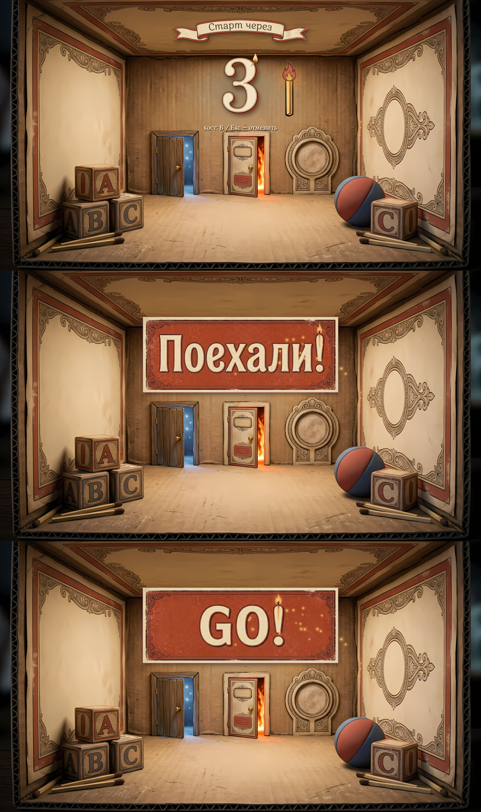
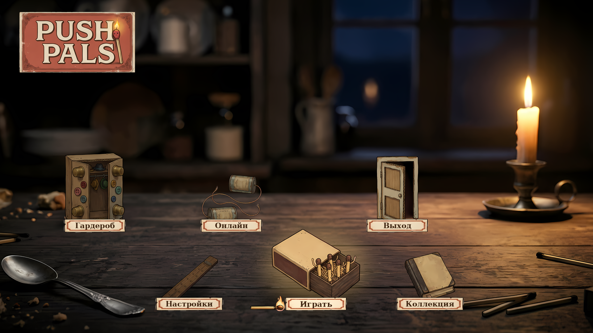

# PUSH PALS — исправления по ревью

Исправления для папки `Assets` (архив `Assets.zip` с Google Drive).
Самой игры в этом репозитории нет: здесь только патчи и копии изменённых файлов.

- `pushpals-fixes.patch` — 8 багов из ревью (сеть, сохранения, достижения), пути от корня Unity-проекта.
- `pushpals-menu-fixes.patch` — меню: настройки, пауза, «Онлайн». Поверх первого.
- `pushpals-ux-fixes.patch` — лобби и язык: временные меню заменены экранами, всё переведено. Поверх второго.
- `pushpals-gameplay-fixes.patch` — игровые системы, управление, сеть: упавшие предметы, счёт сгоревших, переназначение кнопок и др. Поверх третьего.
- `pushpals-menu-ping-fixes.patch` — метка «сюда», эмоции на геймпаде, мягкие шаги, первая попытка нового меню. Поверх четвёртого.
- `pushpals-menu-redesign.patch` — главное меню заново: крупные предметы на столе, свет свечи и тени, ярлыки, явный выбор. Поверх пятого.
- `pushpals-menu-on-table.patch` — банки-телефон «Онлайн» новым рисунком, обе лежат на столе; тени под каждой банкой. Поверх шестого (в нём картинка PNG — `git apply` понимает).
- `pushpals-countdown-music.patch` — отсчёт перед стартом (префаб Countdown), своя музыка у меню и у коробка, край фона при полёте камеры. Поверх седьмого.
- `menu-preview.png` — макет главного меню (с седьмым патчем), собранный из настоящих картинок игры по тем же числам, что в коде.
- `countdown-preview.png` — макет отсчёта: «3» со спичкой-таймером, «Поехали!» и «Go!».
- `menu-music.mp3` — новая музыка главного меню (два круга петли), сыграна тем же алгоритмом, что в игре.
- `files/` — итоговые версии всех изменённых и новых файлов (все восемь патчей), их можно просто скопировать поверх.
- `deleted-files.txt` — файлы, которые третий патч удаляет (при копировании из `files/` удалите их вручную).

## Как применить

Из корня Unity-проекта, по порядку:

```bash
git apply путь/к/pushpals-fixes.patch
git apply путь/к/pushpals-menu-fixes.patch
git apply путь/к/pushpals-ux-fixes.patch
git apply путь/к/pushpals-gameplay-fixes.patch
git apply путь/к/pushpals-menu-ping-fixes.patch
git apply путь/к/pushpals-menu-redesign.patch
git apply путь/к/pushpals-menu-on-table.patch
git apply путь/к/pushpals-countdown-music.patch
```

Если `git apply` ругается на переводы строк, скопируйте файлы из `files/` поверх своих и удалите файлы
из `deleted-files.txt` (переводы строк — как в оригинале: где были CRLF, там CRLF).

## Отсчёт, музыка, край фона (`pushpals-countdown-music.patch`)



| Было | Стало | Файлы |
|---|---|---|
| Нажали «Настройки» или «Коллекция» (нижние предметы) — «камера» летела к предмету, и в кадр въезжал край картинки фона (снизу и сбоку) | Сдвиг «камеры» ограничен: картинка всегда закрывает кадр — и в конце полёта, и по пути. Предмет у края — не точно по центру, зато без пустоты | `MainMenuScreen.cs` |
| У главного меню и коробка одна музыка: меню стоит на столе над той же сценой | Три петли: меню — тихий вальс музыкальной шкатулки при свече (3/4, 76 ударов, гитара «раз — два-три», тёплый тянущийся аккорд), коробок — прежняя укулеле, уровни — как были. Переход плавный: открыли коробок — музыка сменилась. Послушать: `menu-music.mp3` | `MusicPlayer.cs` |
| Отсчёт в лобби — надпись «Старт через 5» поверх игры (OnGUI), «тик» слышал только хост | Префаб **Countdown**: сверху лента «Старт через» (по языку игры), под ней цифра — новая выпрыгивает (1,4 → 1 с лёгким отскоком), старая быстро сжимается и гаснет; тихий деревянный тик на каждой цифре — у всех. Справа горящая спичка-таймер: пламя за весь отсчёт прогорает вниз по палочке. Под цифрой — уровень и «хост: B / Esc — отменить» | `Countdown.cs` (новый), `LobbyBoard.cs` |
| — | «Поехали!» — в начале уровня, как только уедет обложка коробка: табличка выскакивает крупно, лёгкая тряска камеры (по настройке доступности), искры от спички, чирк и «вжух»; через 0,8 с всё гаснет. Заставка уровня (название и цель) — после неё, не под ней | `Countdown.cs`, `LevelRun.cs`, `GameHud.cs`, `MatchboxSleeve.cs` |
| — | Отмена — B / Esc у хоста (как и раньше): отсчёт тут же останавливается и исчезает у всех. Отсчёт поверх обложки коробка: «1» видна, пока коробок закрывается | `Countdown.cs`, `LobbyBoard.cs` |
| — | Длительность — в инспекторе префаба Countdown (её берёт и доска в лобби; префаба нет — 5 с из доски). Там же: сколько держится «Поехали!», сила тряски, громкость тика, цвета запасного текста | `Countdown.cs` |
| — | Нет картинок слов на языке игры (или цифры больше 5) — тот же текст TextMeshPro тем же цветом (кремовый с тёмной обводкой) | `Countdown.cs`, `strings.txt` |
| — | Нарезка: `ui_countdown_digits` → `cd_5` … `cd_1` (тонкие чёрные линии между цифрами выкидываются), `ui_countdown_words_ru` → `cd_title_ru`, `cd_go_ru`, `ui_countdown_words_en` → `cd_title_en`, `cd_go_en` | `UiSheetTool.cs` |
| — | Сборка префаба Countdown (Assets/Prefabs/UI) и запись в реестр префабов | `UiKitBuilder.cs` |
| — | Деревянный тик и «вжух» — синтез при запуске, как остальные звуки без файлов | `SynthClips.cs`, `Sfx.cs` |

Спички-таймера отдельным префабом MenuMatch в присланном проекте нет — спичка собрана из картинки `menu_pointer`
(палочка, повёрнутая головкой вверх, с обугленным кончиком) и пламени `ic_fire`.

### Что сделать в Unity после установки

1. Картинки отсчёта — в `Assets/Art/UI/_Source/` с именами `ui_countdown_digits.png`, `ui_countdown_words_ru.png`,
   `ui_countdown_words_en.png` (оттуда их берёт нарезка).
2. Меню **PushPals → Интерфейс → Нарезать листы UI** — в отчёте у трёх новых листов должно быть «✓» (5 из 5, 2 из 2).
3. Меню **PushPals → Интерфейс → Собрать набор UI** — появится префаб `Assets/Prefabs/UI/Countdown.prefab`
   (длительность и прочее — в его инспекторе). Без него отсчёт тоже работает (собирается в игре, 5 с).

### Что проверить в Unity (отсчёт, музыка)

1. Лобби: «Начать!» у доски — лента, цифры 5…1 с тиком, спичка прогорает; B / Esc у хоста — всё исчезает.
2. Отсчёт до конца — коробок закрывается (цифра «1» поверх), уровень открывается — «Поехали!», искры, лёгкая тряска.
3. По сети: у клиента тот же отсчёт и «Поехали!».
4. Музыка: главное меню — вальс шкатулки; «Играть» — в коробке укулеле; на уровне — своя.
5. Главное меню: «Настройки» и «Коллекция» — за открывшимся экраном нет края картинки.

## Банки «Онлайн» на столе (`pushpals-menu-on-table.patch`)



| Было | Стало | Файлы |
|---|---|---|
| Банки-телефон «Онлайн» стояли у заднего края стола, и верхняя банка висела в воздухе над краем, на фоне стены; концы бечёвки торчали вверх | Новый рисунок банок (из присланной картинки): обе банки лежат на боку, бечёвка — петлями по столу. Вырезаны с пурпурного фона, подогнаны к остальным предметам: тонкий тёмный контур, как тушью, тёплый тон свечи. Нарисованную на фоне тень не берём — у банок свои тени от свечи. Банки стоят ближе, у свечи: и дальняя банка — на столешнице | `menu_obj_online.png` (новая, `Resources/UI/Menu`), `MainMenuScreen.cs` |
| Тень у основания — одно пятно на предмет | Пятен может быть несколько: у банок — под каждой | `MainMenuScreen.cs` |
| Выбранный предмет поднимался на 4 % высоты — лежащие вещи казались парящими | 2,5 %, покачивание мягче; тень остаётся на столе | `MainMenuScreen.cs` |
| Рамка ярлыка задавалась множителем 1,9 — у листа `ui_panels` 200 пикселей на единицу, и рамка вышла бы вдвое тоньше, чем на макете | Множитель по умолчанию: рамка как на макете | `MainMenuScreen.cs` |
| Книга «Коллекция» правее — её ярлык упирался в подсказку «Выбрать» | Книга чуть левее и меньше, ярлык не задевает подсказку и ярлык «Онлайн» | `MainMenuScreen.cs` |

Картинка банок берётся из `Resources/UI/Menu/menu_obj_online.png`; если её нет — старая из листа (код работает и без неё).

### Что проверить в Unity (банки)

1. Обе банки лежат на столе, ничего не висит над его задним краем; при выборе — свечение и лёгкий подъём, тень на месте.
2. Банки по виду не выбиваются из остальных предметов (контур, тон).
3. Картинка `menu_obj_online.png` импортировалась как Sprite (Single) — в инспекторе Texture Type: Sprite (2D and UI).

## Главное меню заново (`pushpals-menu-redesign.patch`)

Меню из пятого патча вышло хуже старого: предметы мелкие и тёмные, стол занимал меньше половины кадра,
ярлыки с красной рамкой походили на ценники, логотип ушёл в угол. Сделано заново, с опорой на старое меню
(крупные предметы, большой логотип по центру) и на эскиз (предметы стоят на столе, у каждого ярлык).

| Было (пятый патч) | Стало | Файлы |
|---|---|---|
| «Камера» показывала всю картинку: стол — узкая полоса внизу | «Камера» ближе (×1,14): столешница — на полкадра, свеча в кадре. При появлении меню камера плавно «отъезжает» к столу | `MainMenuScreen.cs` |
| Предметы мелкие и притушены до 66–86 % | Крупные, как в старом меню: дверь и шкаф — в дальнем ряду, коробок «Играть» — по центру спереди, самый большой. Тон по свету свечи: ближе к ней — светлее (84–97 %) | `MainMenuScreen.cs` |
| Тень — один кружок под предметом | Две тени: мягкое пятно у основания по «следу» предмета и падающая от свечи — размытый силуэт влево-вниз. Без своих шейдеров: размытие — копиями силуэта со сдвигами | `MainMenuScreen.cs`, `UiSoftSilhouette.cs` (новый) |
| Ярлыки — плашки `hud_team_plate` с красной рамкой | Бумажные карточки `input_field` с тонкой рамкой, подпись заглавными (Lora) с разрядкой, ширина — по подписи (и после смены языка), чуть наклонены, с мягкой тенью. Ярлыки лежат поверх всех предметов — их ничто не заслоняет | `MainMenuScreen.cs` |
| Выбранный едва отличался от остальных | Выбранный светлеет и поднимается (тень остаётся на столе — видно, что он оторвался), за ним тёплое свечение, на столе пятно света; его ярлык крупнее, подпись красным, рядом горящая спичка с отсветом. Остальные уходят в полутень | `MainMenuScreen.cs` |
| Логотип — маленькая табличка в углу | Большой, по центру над столом, с мягкой тенью; пока «камера» летит к предмету, логотип и подсказка гаснут | `MainMenuScreen.cs` |
| Предметы расставлены в долях картинки — на других пропорциях экрана разъезжались бы | Сцена 1920×1080 ложится ровно на кадр 16:9 (по низу кадра). На 16:10 (Steam Deck) всё в кадре и ничего не наезжает; на 4:3 сцена тоже целиком, но сверху над логотипом — размытая полоса фона (картинке не хватает высоты); на 21:9 — по бокам размытое продолжение. Углы кадра в полутьме — взгляд на стол | `MainMenuScreen.cs` |

Не изменилось: что открывает каждый предмет, полёт «камеры» к предмету и обратно, выход через «Выйти из игры?»,
возврат из игры в меню, приглашение по сети прямо из меню. Навигация — по рядам: вверх-вниз — пары «дверь — линейка»,
«шкаф — коробок», «банки — книга».

### Что проверить в Unity (главное меню)

1. Меню на 16:9: предметы стоят на столе, ни один не заслоняет ярлыки и логотип; выбранный заметен издалека.
2. Мышь: наведение на предмет или ярлык выбирает, клик по ярлыку открывает то же, что клик по предмету.
3. Стрелки и геймпад: по рядам и между ними; Enter / A — «камера» летит к предмету, экран закрыли — летит обратно.
4. Сменить язык в настройках и вернуться: ярлыки по ширине английских подписей.
5. Окно 16:10 и 21:9: сцена целиком в кадре, предметы не наезжают друг на друга.

## Меню, метка, эмоции, шаги (`pushpals-menu-ping-fixes.patch`)

| Было | Стало | Файлы |
|---|---|---|
| Предметы главного меню висели поверх картинки: шкаф над краем стола, дверь обрезана, без теней, все одинаково яркие; подпись только у выбранного, спичка-указатель свисала сверху | **Переделано в шестом патче (см. выше).** Здесь была первая попытка, как на эскизе: предметы стоят на столешнице в два ряда с перспективой (дальний ряд меньше), у каждого тень от свечи (влево), в тени притушены и теплее; у каждого — бумажный ярлык спереди. Выбранный светлеет, приподнимается, светится, к его ярлыку тянется горящая спичка. Логотип — табличкой в углу. Стрелки и геймпад ходят по рядам (вверх/вниз — между рядами). Расстановка проверена макетом из этих же картинок | `MainMenuScreen.cs` |
| «Метка «сюда»» была в настройках, но в игре ничего не делала | Работает: R3 / G / колёсико мыши — булавка цвета игрока там, куда показывает прицел (стик — луч до пола или стены; мышь — под курсором), круги и «Сюда!», 4 с. По сети видят все (клиент → хост → всем, чужой спичкой нельзя). Клавиша G добавлена в набор управления | `PingMarker.cs` (новый), `NetworkRagdoll.cs`, `PlayerIntentReader.cs`, `PushPalsControls.inputactions`, `strings.txt` |
| «Метка» и «Субтитры» были убраны из настроек | Возвращены | `SettingsScreen.cs` |
| Эмоции с геймпада не срабатывали: стик отпускали раньше LB — выбор сбрасывался; LB раньше стика — эмоцию тут же прерывал правый стик (руки тянулись за прицелом) | Выбор на колесе запоминается; после эмоции правый стик не тянет руки, пока его не отпустят; B — передумать | `PlayerIntentReader.cs` |
| Шаги — резкий стук дерева на каждый полушаг каждой спички, даже упёршись в стену; вчетвером — дробь | Мягкое синтезированное «топ» (4 варианта): только когда спичка правда идёт, не чаще 0,27 с, все вместе не чаще 0,08 с, тише медленно; Тяжёлый ниже, Маленький выше | `SynthClips.cs`, `Sfx.cs`, `WorldSounds.cs` |
| Советы на обложке — 7, номер зашит в коде | +2 совета (метка, эмоции); новые советы подхватываются сами | `MatchboxSleeve.cs`, `strings.txt` |

### Что проверить в Unity (меню, метка, эмоции, шаги)

1. Главное меню — см. раздел шестого патча.
2. Геймпад: LB, наклонить правый стик к эмоции, отпустить стик, потом LB — эмоция играет; и наоборот. B при открытом колесе — отмена.
3. R3 со стиком в сторону стены — булавка на стене; мышь — колёсико или G под курсором. По сети метку клиента видят хост и другие.
4. Шаги: идти по полу — тихо и мягко; упереться в стену — тишина; вчетвером — без дроби.

## Игра, управление, сеть (`pushpals-gameplay-fixes.patch`)

| Было | Стало | Файлы |
|---|---|---|
| Предмет, упавший в пропасть (кубик к высокому краю в W1_1, ключ в «Варенье» и «Подарках», ящики), пропадал насовсем — уровень не пройти, только заново | Упал ниже края мира — возвращается на своё место (с дымком). Пока висит на шарнире или нитке — не трогается. Сцены править не нужно: уровень сам находит всё, что носят (слои Grabbable / Metal) | `LevelRun.cs`, `PlayerManager.cs` (`FallY`) |
| «Сгорели: N», «Ни одной искры зря» и задача предателя «пусть сгорят 2 спички» считали только игроков-призраков: догоревшая спичка, на смену которой вышла целая из рюкзака, не считалась | Считаются все спички, сгоревшие дотла | `LevelRun.cs` |
| Дверь «все кнопки» (`requireAll`) узнавала о кнопке только при её первом нажатии и открывалась от первой же | Кнопки, замки, ленты и торт регистрируются у дверей сразу | `Door.cs`, `PressurePlate.cs`, `KeyLock.cs`, `RibbonGate.cs`, `CandleGoal.cs` |
| Подключение к другу не удалось или не пустили — сцена всё равно перезагружалась: главное меню пропадало, игрок молча оказывался в коробке | Не подключился — сцена та же, причина видна на экране «Онлайн» | `NetSession.cs` |
| Хост закрыл игру / связь пропала — клиент молча оставался один на чужом уровне посреди прохождения | Клиент попадает в свой коробок и видит окно «Сетевая игра закончилась» с причиной | `NetSession.cs`, `UiDialog.cs` (`Info`), `strings.txt` |
| «Кто может войти» хранится между запусками; «никто» из прошлой игры молча не пускал друзей, а на экране «Онлайн» этого не видно | Выбор — прямо в «Онлайн» (хосту) | `OnlineScreen.cs` |
| Без Steam кнопки «Создать игру», «Найти», «Войти по коду» нажимались и ничего не делали | Без Steam они недоступны (игра по локальной сети работает) | `OnlineScreen.cs` |
| Переназначение на геймпаде нельзя отменить с геймпада; Esc-отмена и новая кнопка B закрывали весь экран настроек | Start — отмена на геймпаде; пока идёт переназначение, Esc / B / Start / правый клик не закрывают экран | `KeybindRow.cs`, `UiRoot.cs`, `strings.txt` |
| Назначил кнопку, которая уже у другого действия, — одна кнопка делала два дела | Действия меняются кнопками (занятая переходит к прежней кнопке этого действия) | `KeybindRow.cs` |
| «Простое управление»: игра разжала руку (смена спички, возрождение, сорвалась), а «хват» оставался — пустая рука хватала всё подряд | Рука опустела — хват снят, нажми ещё раз | `PlayerIntentReader.cs` |
| В настройках «Метка «сюда»» (в игре не работает) и «Субтитры» (озвучки нет) — ничего не делали; подпись к мыши «(HUD, следующий шаг)» | Убраны; подпись — по-человечески | `SettingsScreen.cs`, `strings.txt` |
| Дверь уровня в лобби грузила уровень без названия на обложке | Название — как при старте у доски | `LevelDoor.cs` |
| «Заново»: каждый кадр искались все `PlayerInput` в сцене | Берутся у `PlayerManager` | `LevelRun.cs` |
| Отключение клиента у хоста: спичка могла быть уже удалена — ошибка | Проверка | `NetSession.cs` |

### Что проверить в Unity (игра, управление, сеть)

1. W1_1: столкнуть кубик в пропасть — он появляется на своём месте. W2_2: лопнуть шарик над пропастью — ключ возвращается.
2. Вдвоём (у каждого пара): дать спичке догореть — после уровня «Сгорели: 1», «Ни одной искры зря» не даётся.
3. Настройки → Управление: геймпадом начать переназначение и нажать Start — отмена, экран открыт; назначить «Прыжок» на клавишу «Боднуть» — они поменялись.
4. Доступность → Простое управление: схватить ящик, сменить спичку (Y / F) — рука после смены пустая и сама не хватает.
5. Сеть: войти по неверному коду — главное меню и «Онлайн» на месте; клиент в игре, хост выходит — клиент в своём коробке с окном «Сетевая игра закончилась».

## Лобби и язык (`pushpals-ux-fixes.patch`)

| Было | Стало | Файлы |
|---|---|---|
| «Настройки игры» у доски — временное меню (рисуется поверх игры, свои кнопки, только по-русски) | Экран `GameSetupScreen` в стиле остальных: уровень (кнопка «Выбрать» → карта миров), режим, огонь, шлепки, кто может войти, «Онлайн», цель уровня, «Начать!» / «Отменить старт». Карта и «Онлайн» открываются поверх — закрылись, и снова настройки. Из паузы — поверх паузы; «Начать!» закрывает и её | `GameSetupScreen.cs` (новый), `PlayerIntentReader.cs`, `PauseScreen.cs` |
| Шкаф в лобби — второе временное меню, не такое, как «Гардероб» в главном меню; в нём ещё раз микрофон и громкость голосов | Шкаф открывает тот же «Гардероб» для подошедшего игрока: его шапка и дерево плюс «Спички» (любые / пары / по одной — по числу игроков, «сейчас у игрока N»). Микрофон и громкость — только в «Настройки → Звук». Игрок ушёл — шкаф закрывается | `WardrobeScreen.cs`, `PlayerIntentReader.cs` |
| Выбор английского языка оставлял половину игры русской: доска, двери, таблички-подсказки (38 текстов в сценах), шкаф, места для друзей, эмоции, статусы сети, причины «не пустили» | Всё через таблицу локализации: +137 строк ru/en. Тексты из сцен переводятся по исходному русскому тексту (`Loc.Auto`), сцены править не нужно. Причину отказа хост шлёт кодом — клиент видит её на своём языке | `Loc.cs`, `strings.txt`, `LobbyBoard.cs`, `LevelDoor.cs`, `TutorialSign.cs`, `JoinSlots.cs`, `LobbySecret.cs`, `RibbonGate.cs`, `CandleGoal.cs`, `TeamExit.cs`, `LobbyStation.cs`, `EmoteWheel.cs`, `JoinHint.cs`, `GameRules.cs`, `NetSession.cs`, `UiNames.cs` |
| Подсказки отправляли к отладочной панели: «Пригласить или выйти — F2», «Предатель — только по сети (F2)», «пригласить — у доски» | Везде «пауза → Онлайн» | `JoinHint.cs`, `GameRules.cs`, `strings.txt` |
| Доска: «Хост: X / E у доски или Start / Esc» — но Start / Esc открывает паузу | «Настройки игры (хост): X / E у доски или пауза» | `LobbyBoard.cs` |
| Подсказка «Выйти: держать Start / Esc» — непонятно, что выйти из команды, а не из игры; про паузу ни слова | «Пауза — Start / Esc, держать — уйти из команды» | `strings.txt` |
| «Начать заново» и «В коробок» в паузе посреди уровня срабатывали сразу (по сети — у всех) | Сначала «точно?»: прохождение начнётся сначала, золотые спички останутся. Уровень уже пройден — без вопроса | `PauseScreen.cs` |
| Мёртвый код: `PlayerMenu`, `HostMenu`, `WardrobeMenu`, `SettingsMenu`, `PauseMenu`, `Unlocks.NeedText/NewSince` | Удалён; выход из игры — `MainMenuScreen.QuitGame` | см. `deleted-files.txt` |

### Что проверить в Unity (лобби и язык)

1. Компиляция без ошибок (удалены 5 классов — если на них ссылается что-то вне `Assets/Scripts`, Unity покажет).
2. Лобби: подойти к шкафу, X / E — «Гардероб» с одним игроком и «Спичками»; вдвоём — пары, вчетвером — по одной; выбор меняет рюкзак.
3. Хост у доски, X / E — «Настройки игры»; «Выбрать» → карта → уровень → снова настройки; «Начать!» — отсчёт. Не хост — подсказка над спичкой.
4. Пауза в лобби → «Настройки игры» — поверх паузы, «Назад» возвращает в паузу.
5. Настройки → Игра → English: доска, двери, таблички на уровнях, места для друзей, колесо эмоций, «Онлайн» — по-английски.
6. Пауза на уровне → «Начать заново» — окно «точно?».

## Меню (`pushpals-menu-fixes.patch`)

| Было | Стало | Файлы |
|---|---|---|
| Настройки → сменить язык → «Назад»: в главное меню не вернуться. Экран настроек удалялся и открывался новый, а главное меню ждало закрытия старого и оставалось «приближенным» и глухим к кликам | Экран собирается заново на месте (`UiScreen.Rebuild`), «Назад» возвращает к столу | `UiScreen.cs`, `SettingsScreen.cs` |
| В паузе нет пути в главное меню; «Выйти из игры» — единственный выход | Пункт «Главное меню»: с уровня — через коробок, в своём коробке — сразу; по сети — с вопросом «точно?» (хост закончит игру у всех) | `PauseScreen.cs`, `MainMenuScreen.cs`, `LobbyBoard.cs`, `Online.cs`, `NetSession.cs` |
| Окно «Выйти из игры?» могло сработать тем же нажатием, что его открыло | Кнопки окна не срабатывают первые 0,3 с; общий `UiDialog.Confirm` | `UiDialog.cs` |
| «Онлайн» → «Создать игру» — на экране ничего не меняется, «Назад» молча уводит в коробок | После создания — подсказка «Игра создана! Дай друзьям код…», код лобби в своей строке с «Копировать», пригласить, кто в игре; нижняя кнопка честно называется «В коробок» (Esc — то же) и ведёт туда сразу, без возврата к столу | `OnlineScreen.cs`, `MainMenuScreen.cs` |
| В игре экран «Онлайн» не открыть: «Настройки игры» звали отладочную панель F2 | «Онлайн» в паузе и в «Настройках игры»; оттуда нижняя кнопка — «Назад» | `PauseScreen.cs`, `HostMenu.cs` |
| «Найти игры друзей» находил открытые игры чужих людей, а игры друзей (только для друзей) — нет | «Найти открытые игры» + подсказка, что к другу входят через Steam («Присоединиться» / приглашение) | `strings.txt` |
| «Настройки игры» → «Уровень» → выбрали на карте — меню закрывается, «Начать!» искать заново | После карты миров и «Онлайн» снова открываются «Настройки игры» | `HostMenu.cs`, `PlayerIntentReader.cs` |
| На итоге уровня нет «Заново» (только удержание R / Select) | Кнопки «Дальше» · «Начать заново» · «В коробок» | `LevelResultScreen.cs`, `LevelRun.cs` |

Новые строки локализации (ru/en): `pause.main_menu`, `pause.main_menu_confirm`, `pause.leave_online`,
`online.hosting_hint`, `online.host_hint`, `online.client_hint`, `online.to_box`; изменены `online.find`, `online.found_hint`.

### Что проверить в Unity (меню)

1. Главное меню → Настройки → Игра → сменить язык → «Назад»: «камера» отъезжает, предметы на столе снова нажимаются, подписи на новом языке.
2. Пауза в коробке → «Главное меню» — стол сразу; на уровне — коробок закрывается, открывается со столом. «Играть» — снова в коробок.
3. Пауза → «Выйти из игры» Enter'ом / A: окно спрашивает, а не закрывает игру сразу.
4. Главное меню → Онлайн → «Создать игру»: подсказка и код; «В коробок» (или Esc) — сразу в коробок хостом.
5. В коробке: Пауза → Онлайн — код и приглашения, «Назад» — обратно в паузу. «Настройки игры» → «Онлайн…» / «Уровень» → после закрытия снова «Настройки игры».
6. Итог уровня: «Начать заново» перезапускает уровень; по сети у клиента кнопок нет («Ждём хоста»).

## Сеть и сохранения (`pushpals-fixes.patch`)

### Что исправлено

| # | Баг | Файлы |
|---|---|---|
| 1 | Приглашение Steam, принятое во время игры, выкидывало из сессии и никуда не входило: Netcode закрывает сессию только в конце кадра. Теперь вход откладывается до полного закрытия старой сессии | `NetSession.cs` |
| 2 | Двойной клик «Войти» ломал сессию. Пока идёт вход в лобби, новый вход, хост или локальная игра не начинаются; если сессия началась, пока ждали Steam, лишнее лобби покидается | `NetSession.cs` |
| 3 | Облако заменяло сохранение целиком по времени записи. Теперь прогресс складывается из обоих (пройдено на любом ПК, маска золотых спичек — OR, лучшее время, достижения, колпак), а из более нового берутся только настройки и внешний вид | `SaveSystem.cs` |
| 4 | Запись сохранения: удаление старого файла до переноса нового. Теперь `File.Replace` с копией `.bak`; чтение пробует основной файл, потом `.tmp`, потом `.bak`; нечитаемый файл откладывается в `.broken`, а не затирается | `SaveSystem.cs` |
| 5 | Пакеты намерений не по порядку давали лишние прыжки, удары, смены спички и эмоции. У пакета появился номер `Seq`, хост выкидывает опоздавшие | `NetworkRagdoll.cs` |
| 6 | Хост доверял данным клиентов: длина личного сообщения проверяется по размеру пакета; у тестового PCM-голоса частота только 8–48 кГц; роль, ход задачи, итог и достижение «Предателя» принимаются только от хоста; голос — только от человека в игре и за другого человека в игре | `NetSession.cs`, `NetworkVoice.cs`, `Online.cs`, `TraitorRound.cs` |
| 7 | Достижения Steam читались до прихода статистики. Теперь синхронизация идёт, когда Steam прислал статистику (`OnUserStatsReceived`); до этого платформа «недоступна», открытое хранится в сохранении и отправляется позже | `SteamAchievements.cs` |
| 8 | Опоздавший в «Предателе» мог не получить роль. Клиент без роли раз в 1,5 с переспрашивает хоста (`t_ask`), хост отвечает (опоздавший — честная спичка); повтор роли карточку второй раз не показывает | `TraitorRound.cs` |

`NetIntent` стал на 2 байта длиннее: хост и клиенты должны быть одной сборки (как и раньше).

### Что проверить в Unity (сеть и сохранения)

Код не компилировался — в контейнере нет Unity и сборок Netcode/Steamworks; синтаксис проверен парсером C#.

1. Компиляция без ошибок (Facepunch.Steamworks: `SteamUserStats.OnUserStatsReceived`, `Result.OK`).
2. Хост + клиент: во время игры принять приглашение в другое лобби — клиент выходит и входит в новое.
3. Быстро дважды нажать «Войти» в списке лобби — один вход, сессия живая.
4. Сохранения: удалить `pushpals_save.json`, оставив `.tmp` или `.bak`, — прогресс восстанавливается; испортить JSON — рядом появляется `.broken`.
5. Steam Cloud на двух ПК: пройти разные уровни на каждом — после синхронизации пройдено всё.
6. Автотест-бот (`-pp-bot`, `-pp-voicetest`): голос-тон слышен, «Предатель» с 3+ людьми раздаёт роли и голосует как раньше.
